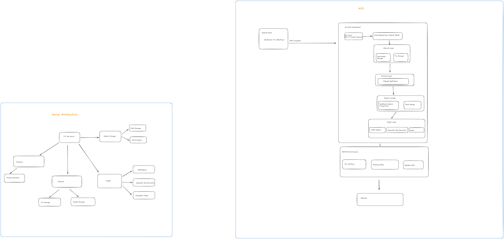

# Cpp-VPN-Core: High-Performance Linux Tunneling Engine

A Linux-native VPN core built for low-latency packet processing and high-throughput networking. This engine implements a custom UDP-based protocol focused on syscall efficiency, architectural resilience, and session persistence.



## 🛠 High-Level Engineering Overview

Cpp-VPN-Core is a systems-level networking engine designed to maximize packet-per-second (pps) performance on Linux. By leveraging modern kernel interfaces and a zero-allocation packet pipeline, it minimizes the overhead traditionally associated with userspace tunneling.


### 🚀 Core Performance Optimizations
* **Syscall Batching (recvmmsg/sendmmsg):** Optimized the I/O pipeline to significantly reduce the cost of kernel-to-userspace context switches by processing multiple datagrams in a single system call.
* **Low-Latency Profiling:** Integrated **RDTSC-based cycle counting** for precise measurement of decryption and lookup costs, enabling data-driven optimization of the packet pipeline.
* **Non-Blocking I/O Multiplexing:** Utilizes `select()` and non-blocking sockets to manage multiple client streams within a single-threaded high-speed loop.
* **Zero-Allocation Mentality:** Designed for minimal heap fragmentation, focusing on in-place memory manipulation during packet decryption and routing.

### 🏗 Architectural Features
* **Stateless Session Roaming:** Decouples a client's tunnel identity from their network identity using a persistent **32-bit Session ID**. This enables seamless "Roaming"—the ability to maintain a VPN connection across IP/Port changes (e.g., Wi-Fi to 4G) without re-handshaking.
* **Virtual IP Pool Management:** Implements an internal **IP Reservation and Lifecycle System** for assigning and recycling internal VPN addresses.
* **Custom Protocol Handshake:** A 3-step handshake utilizing **Diffie-Hellman (DH)** key exchange for secure, per-session XOR key derivation.

---

## 📐 System Flow & Logic

### 1. The Handshake Protocol
The handshake ensures perfect forward secrecy for the session key before any data traffic is accepted.


### 2. Traffic Processing Loop
Incoming UDP packets are parsed for their custom **5-byte header** to determine if they are control signals or encrypted data.


---

## 📊 Performance Metrics
*Calculated using integrated RDTSC profiling on Linux x86_64.*

| Operation | Metric |
| :--- | :--- |
| **I/O Strategy** | `recvmmsg` / `sendmmsg` (Batching) |
| **Max Batch Size** | 8 Packets per Syscall |
| **Profiling Method** | Serialized RDTSC (Cycle Accurate) |
| **Routing Strategy** | Session ID-based Roaming |

---

## 🛠 Technical Stack
* **Language:** C++17 (Focus on performance and RAII)
* **Build System:** CMake (With modular profiling toggles)
* **Network Interfaces:** Linux TUN/TAP, UDP Sockets
* **Cryptography:** Diffie-Hellman key exchange and XOR stream cipher (protocol v1 placeholders); pluggable AEAD cipher layer with libsodium and OpenSSL backends (ChaCha20-Poly1305, AES-256-GCM), on the wire with protocol v2
* **System Utilities:** `recvmmsg`, `sendmmsg`, `fcntl`, `ioctl`

---

## 🧭 Design Documents & Roadmap

> **Security status:** on the wire, protocol v1 still uses the placeholder XOR cipher and small-parameter Diffie-Hellman. They don't provide confidentiality, integrity, or client authentication. The replacement AEAD ciphers (libsodium ChaCha20-Poly1305 / AES-256-GCM, optional OpenSSL) are built and tested since M2 ([crypto/backends/](crypto/backends/)). They go on the wire with protocol v2 (M4).

Target designs and their rationale are in [docs/design/](docs/design/README.md):

| # | Document | Status | Implementation |
|---|---|---|---|
| 01 | [Pluggable transport cipher layer](docs/design/01-cipher-layer.md) | Accepted | M1–M2 done; on the wire in M4 |
| 02 | [Handshake (protocol v2)](docs/design/02-handshake.md) | Accepted | M4 |
| 03 | [Access tickets and issuer](docs/design/03-tickets.md) | Accepted | M5 |
| 04 | Multi-node deployment | 4a (node config and identity) accepted; rest parked | 4a done in M3 |

- **Plan:** [implementation plan](docs/plan/implementation-plan.md) (milestones M0–M7) · [parked discussions](docs/plan/parked-discussions.md)
- **Measurements:** [experiments/](experiments/README.md): [001: per-packet crypto cost](experiments/001-crypto-per-packet-cost/README.md) · [002: `crypto_bench`, all backends](experiments/002-crypto-bench-backends/README.md)
- **Tests:** [tests/](tests/README.md) (GoogleTest + CTest; runs in every Docker build)
- **Testing without the phone:** [Windows test client](clients/windows/README.md) (`--probe` needs no admin)

## 📚 Reading Guide

New to the concepts in the design docs (AEAD, Noise IK, X25519, tickets…)? The **[reading guide](docs/reading-guide.md)** has:
- a 5-minute walkthrough of the current engine, with code links;
- a glossary of every term, each pointing to where we use it and to its primary source;
- ordered reading paths with the exact sections to read.

| To understand | Start with |
|---|---|
| The current engine (TUN, batching, v1 protocol) | [Reading path A](docs/reading-guide.md#path-a--understand-todays-engine--12-h) · [Linux TUN/TAP](https://docs.kernel.org/networking/tuntap.html) · [recvmmsg(2)](https://man7.org/linux/man-pages/man2/recvmmsg.2.html) |
| Why XOR is replaced, and what AEAD is | [Path B](docs/reading-guide.md#path-b--why-the-current-crypto-must-go--1-h) · [Cryptopals 1.3](https://cryptopals.com/sets/1/challenges/3) · [RFC 8439](https://www.rfc-editor.org/rfc/rfc8439) · [libsodium AEAD](https://doc.libsodium.org/secret-key_cryptography/aead) |
| The v2 handshake | [Path C](docs/reading-guide.md#path-c--the-v2-handshake--34-h) · [WireGuard whitepaper](https://www.wireguard.com/papers/wireguard.pdf) · [Noise spec](https://noiseprotocol.org/noise.html) · [Noise Explorer: IK](https://noiseexplorer.com/patterns/IK/) |
| Tickets and access control | [Path D](docs/reading-guide.md#path-d--tickets-and-access-control--12-h) · [RFC 8032 (Ed25519)](https://www.rfc-editor.org/rfc/rfc8032) |
| The Windows client | [Path E](docs/reading-guide.md#path-e--windows-client-internals--1-h) · [Wintun](https://www.wintun.net/) |

---

## ⚙️ Building the Core

```bash
# Dependencies (Ubuntu 22.04); libssl-dev only for -DWITH_OPENSSL=ON
sudo apt-get install -y build-essential cmake libsodium-dev libssl-dev libgtest-dev

# Build, run the unit tests, benchmark the ciphers
cmake -S . -B build -DCMAKE_BUILD_TYPE=Release -DWITH_OPENSSL=ON
cmake --build build -j
(cd build && ctest --output-on-failure)
taskset -c 0 ./build/crypto_bench --sizes 64,512,1400

# Or build and test in Docker (no local dependencies)
docker build --target builder -t vpn-builder-stage .

# Execution (requires root for TUN device creation)
sudo ./build/vpn_server
```

### Running a node with a config file (M3)

```bash
sudo mkdir -p /etc/cppvpn
sudo ./build/vpn_server --gen-key /etc/cppvpn/node.key        # once; prints the node public key
sudo cp deploy/node.conf.example /etc/cppvpn/node.conf         # edit id, port, tun_cidr …
sudo ./build/vpn_server --check-config                         # validate, print effective config
sudo ./build/vpn_server                                        # reads /etc/cppvpn/node.conf
sudo ./build/vpn_server --set node.port=6000                   # one-off override
```

- **Without a config file** the server runs with the built-in defaults, as before M3 (port 5555, `tun0` configured externally, pool 10.8.0.2–10.8.0.101).
- **With `tun_cidr`** the server sets the `tun0` address itself. NAT (MASQUERADE) and the firewall stay part of the deployment.
- **Reference:** every key is documented in [deploy/node.conf.example](deploy/node.conf.example); `vpn_server --help` lists the options.

The legacy script [scripts/runbuild.sh](scripts/runbuild.sh) builds without a build type (`-O2`). Release builds add `-O3` ([experiment 002](experiments/002-crypto-bench-backends/README.md)).

---

## 📫 Professional Contact
For technical inquiries, architectural review, or professional collaboration

Repository: shivesh1606/Cpp-VPN-Core

LinkedIn: https://www.linkedin.com/in/shivesh-chaturvedi-14ab321b3/

Email: shivesh.dev.projects@gmail.com

## ⚖️ License

This project is licensed under the **Apache License, Version 2.0**. 

The Apache 2.0 license is a permissive license that allows for the use, modification, and distribution of the software, provided that the original copyright notice and disclaimers are preserved. It also includes an explicit grant of patent rights from contributors to users.

For the full legal text, please see the [LICENSE](LICENSE) file.